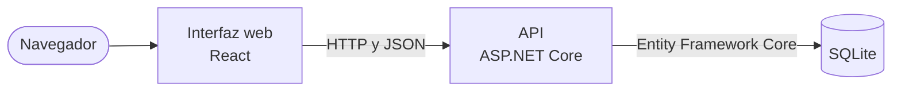

# Cómo está montado el proyecto

Un plano de situación. El detalle de cada parte se saca del código.

## Las partes

| Parte | Dónde está | Qué hace |
|---|---|---|
| Interfaz | `src/interfaz/` | Las pantallas. Llama a la API con el prefijo `/api`, que el proxy de Vite quita |
| API | `src/` | Rutas, reglas y acceso a los datos, en un solo proyecto |
| Datos | `src/Datos/` | El contexto `Datos` y la carga de datos de ejemplo |
| Migraciones | `src/Migrations/` | Los cambios del esquema |

La API se organiza por lo que gestiona, con una carpeta por cada cosa: `src/Incidencias/`, `src/Zonas/`. Lo nuevo va donde lo demás de su clase. Las rutas son de API mínima, en un fichero `<Cosa>Rutas.cs` por carpeta.

La aplicación no distingue quién ha entrado: no tiene usuarios ni permisos.

## Convenciones que no se ven en una sola clase

**Errores.** Todos los devuelve `src/Incidencias/Errores.cs`, con Problem Details y un mensaje para quien usa la aplicación. Si la ruta apunta a algo que no existe, 404. Si la ruta es buena y falla un dato del cuerpo, 400: una zona que no existe responde así, y un dato nuevo que haga referencia a otra entidad sigue ese patrón. Si la petición choca con el estado de la incidencia, 409.

**La hora.** El código se la pide a `TimeProvider`, nunca a `DateTime.Now`. Las pruebas ponen un reloj parado.

**El rojo.** Es `#C62828`, en la variable `--rojo` de `src/interfaz/src/estilos.css`, y se aplica con la clase `aviso-rojo`. Sobre blanco da 5,62:1. Un estado nunca se distingue solo por el color: lleva también su texto.

**Datos de ejemplo.** Salen de `src/Datos/CargaDeEjemplo.cs`, siempre los mismos, con las fechas relativas a hoy. La incidencia 1 sigue abierta, porque las pruebas parten de ella.
