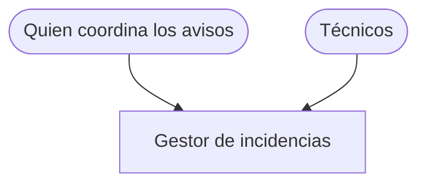
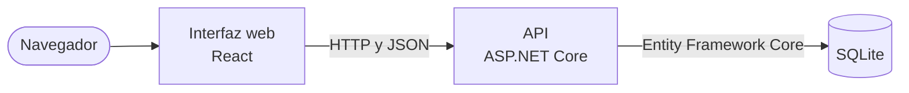
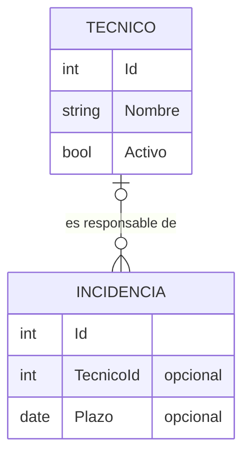
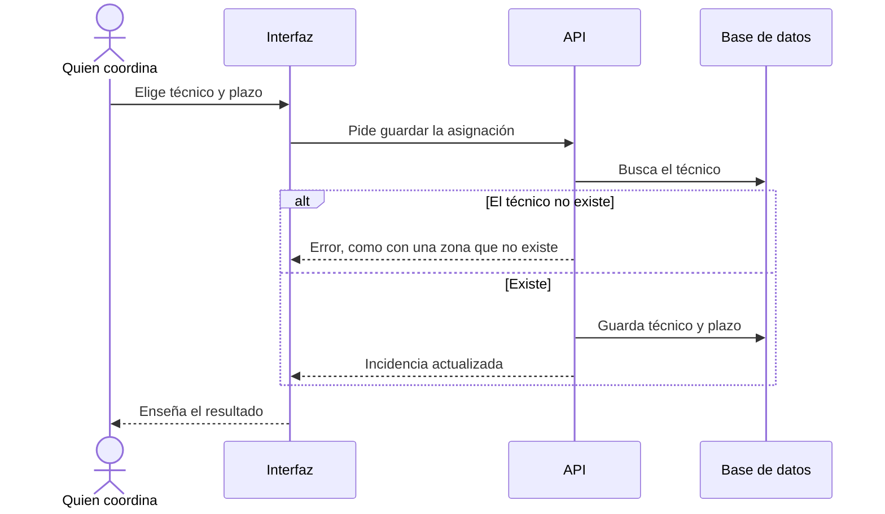

# Técnico responsable y plazo · Arquitectura

## 1. Introducción y objetivos

Cada incidencia dice quién responde de ella y para cuándo. Requisitos: RF-01 a RF-05 y RNF-01, en `docs/encargo/requisitos.md`.

## 2. Restricciones

Las tecnologías del repositorio. El cliente lo quiere antes de Navidad.

## 3. Contexto y alcance

## 5. Vista de bloques

| Elemento del diseño | Requisito | Dónde va |
|---|---|---|
| Lista de técnicos, que mantiene quien coordina | RF-03 | `src/Tecnicos/` |
| Técnico y plazo en la incidencia, opcionales | RF-01, RF-02 | `src/Incidencias/` |
| Columnas y filtro en la lista | RF-04, RF-05 | La pantalla de la lista |
| Migración de la base de datos | RF-01, RF-02 | Las incidencias que ya existen quedan sin técnico y sin plazo |

## 6. Vista de ejecución

## 8. Conceptos transversales

Los errores siguen el patrón que ya usa la API, en `docs/arquitectura.md`.

## 9. Decisiones de arquitectura

- [0001](../decisiones/0001-lista-de-tecnicos-propia.md) · La lista de técnicos se mantiene en la aplicación. Aceptada.
- [0002](../decisiones/0002-baja-de-un-tecnico.md) · Un técnico que se va se marca como inactivo. Propuesta.

## 10. Requisitos de calidad

Se usa desde el móvil, en el edificio (RNF-01). Lo que está fuera de plazo se ve de un vistazo,
también para quien no distingue el rojo (RF-04).

## 11. Riesgos y deuda técnica

La exportación tiene técnicos escritos de varias formas y avisos a nombre de Tomás, que ya no está. Si hubiera que importarla, habría que limpiarla antes.

## 12. Glosario

Ver `docs/vocabulario.md`.

## Pantallas

### Lista de incidencias
- Columna Técnico: el nombre, o «Sin asignar».
- Columna Plazo: la fecha. Si está fuera de plazo, la fecha en rojo (#C62828 sobre blanco, 5,62:1) con el texto «Fuera de plazo».
- Filtro por técnico, encima de la lista, con la etiqueta visible «Técnico».

## Decisiones tomadas

- La lista de técnicos va en la aplicación, y la lleva quien coordina. «Que la lleve Elena
  en la propia aplicación. Lo de sacarla de nóminas, no» (respuesta del cliente, 28-10-2026).

## Decisiones pendientes

1. Qué pasa cuando un técnico se va. El cliente pide no perder quién llevaba cada aviso,
   y que no queden avisos abiertos a su nombre sin que nadie se entere. «Cómo se hace,
   ya es cosa del equipo de desarrollo». Opciones: impedir la baja, quitarle los avisos,
   o marcarlo inactivo y avisar.
